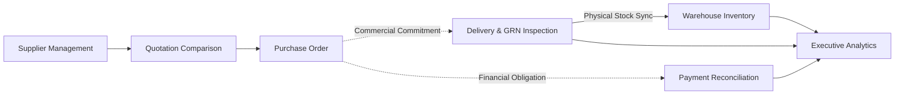
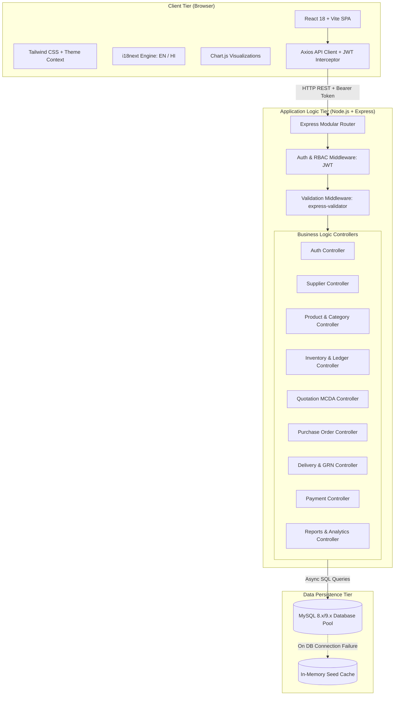
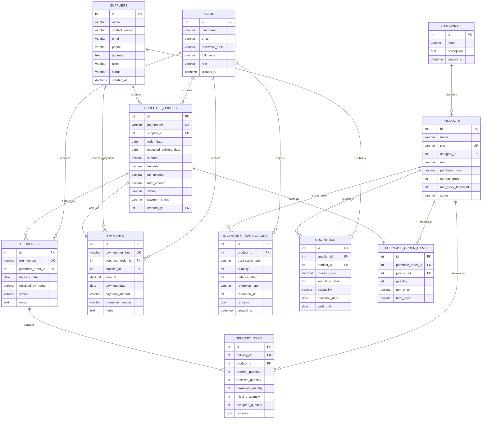
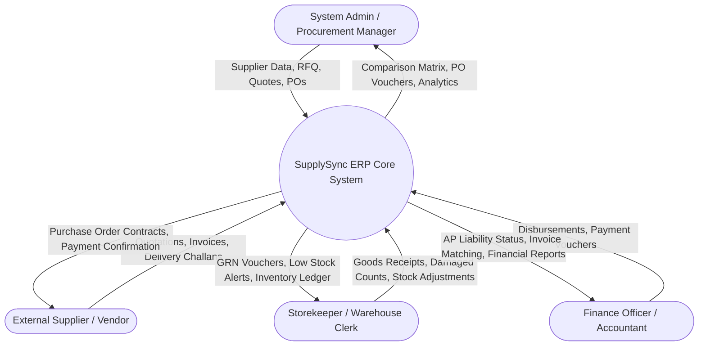
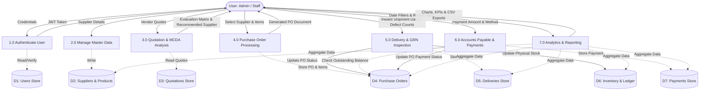

# SupplySync – Comprehensive Final Project Documentation

**Project Title:** SupplySync: Integrated Supplier, Procurement, and Purchase Management ERP  
**Academic Degree:** Capstone Project / Individual Final Year Dissertation  
**Technology Stack:** React 18, Vite 6, Tailwind CSS 3, Node.js, Express.js, MySQL 8.x/9.x, Chart.js, i18next  
**Architecture:** 3-Tier Enterprise Client-Server Architecture (RESTful API + In-Memory Fallback Cache)  
**Document Version:** 1.0.0 (Production Release)  
**Date:** November 2026  

---

## Table of Contents
1. [Project Abstract](#1-project-abstract)
2. [Introduction](#2-introduction)
3. [Problem Statement](#3-problem-statement)
4. [Objectives](#4-objectives)
5. [Existing System](#5-existing-system)
6. [Proposed System](#6-proposed-system)
7. [Functional Requirements](#7-functional-requirements)
8. [Non-Functional Requirements](#8-non-functional-requirements)
9. [Technology Stack](#9-technology-stack)
10. [System Architecture](#10-system-architecture)
11. [Entity-Relationship (ER) Diagram](#11-entity-relationship-er-diagram)
12. [Data Flow Diagrams (DFD Level 0 & Level 1)](#12-data-flow-diagrams-dfd-level-0--level-1)
13. [Database Design & Data Dictionary](#13-database-design--data-dictionary)
14. [Module Descriptions](#14-module-descriptions)
15. [Visual Walkthrough & Component Wireframes](#15-visual-walkthrough--component-wireframes)
16. [Testing Documentation & Verification Matrix](#16-testing-documentation--verification-matrix)
17. [Conclusion](#17-conclusion)
18. [Future Scope](#18-future-scope)
19. [Installation & Deployment Instructions](#19-installation--deployment-instructions)
20. [Comprehensive Viva Questions & Answers](#20-comprehensive-viva-questions--answers)

---

## 1. Project Abstract

**SupplySync** is a modern, enterprise-grade **Procure-to-Pay (P2P)** web application and enterprise resource planning (ERP) system designed specifically for Micro, Small, and Medium Enterprises (MSMEs). Modern businesses often suffer from fragmented supply chain operations, where commercial procurement decisions are disconnected from real-time physical warehouse inventory and finance disbursement records. This fragmentation leads to erroneous stock accounting, unverified supplier price variations, delayed order fulfillments, and financial overpayments.

SupplySync bridges these operational divides through an integrated web platform. The system enforces strict business logic across the procurement lifecycle:
- It eliminates the common flaw of premature inventory increments upon Purchase Order (PO) creation by strictly updating physical stock only upon inward Goods Received Note (GRN) acceptance.
- It introduces a Multi-Criteria Decision Analysis (MCDA) quotation engine that evaluates vendor pricing alongside delivery lead times to prevent suboptimal sourcing.
- It provides a defect isolation workflow separating gross received units from damaged or missing stock.
- It enforces accounts payable safeguards preventing disbursements from exceeding verified purchase order balances.
- It delivers native bilingual accessibility (English and Hindi / हिन्दी) and dark/light mode customization, ensuring seamless adoption by executive managers and ground-level warehouse operators alike.

Supported by 11 normalized database tables in MySQL and an automated failover cache, SupplySync guarantees high data integrity, transactional consistency, auditability, and executive business intelligence.

---

## 2. Introduction

Supply chain management forms the operational backbone of any manufacturing, wholesale, or distribution enterprise. Within an enterprise, the **Procure-to-Pay (P2P)** pipeline spans the entire sequence of events from identifying purchasing requirements and comparing supplier quotations, to generating legal purchase orders, receiving inward shipments, inspecting product quality, and disbursing payments to vendors.

In enterprise corporations, complex software such as SAP S/4HANA or Oracle Cloud SCM handles these processes. However, such solutions are cost-prohibitive, complex to deploy, and ill-suited for MSMEs. As a result, small-to-medium businesses continue to rely on manual spreadsheets, paper challans, and ad-hoc phone communications.

**SupplySync** provides an accessible, robust, lightweight, and modern alternative. Built upon the React-Node-Express-MySQL stack, SupplySync packages enterprise-grade workflows into an intuitive user interface with localized language support, granular audit trails, automated mathematical reconciliations, and responsive analytics.

---

## 3. Problem Statement

Manual and semi-automated procurement practices in typical MSME environments suffer from critical operational vulnerabilities:

1. **Premature Stock Inflations:** Standard generic inventory apps increment stock count as soon as a purchase order is submitted. If the supplier delays the shipment, cancels the order, or ships partial deliveries, the inventory ledger displays ghost stock, disrupting production planning and sales commitments.
2. **Suboptimal Sourcing Decisions:** Purchasing managers often select suppliers based on memory or raw unit price alone, ignoring past lead times and delivery reliabilities. This results in costly stock-outs and production stoppages.
3. **Unrecorded Quality Defects & Missing Shipments:** Without a formal Goods Received Note (GRN) inspection step, damaged items received at the loading dock get absorbed into saleable inventory. Returning these items later leads to disputes with vendors.
4. **Overpayment & Duplicate Invoicing:** Fragmented accounts payable records lead to payments being disbursed without reconciling against actual delivered quantities, leading to payment leakages.
5. **Language & Usability Barriers:** Ground-level warehouse personnel in regional hubs often struggle with English-only enterprise software, leading to data entry errors or avoidance of the software altogether.

---

## 4. Objectives

The primary engineering and business objectives of SupplySync are:

1. **Enforce the Strict P2P Decoupling Rule:** Guarantee that creating or approving a Purchase Order generates a commercial commitment without altering physical inventory. Stock updates occur solely upon physical receipt and quality verification.
2. **Implement Multi-Criteria Quotation Comparison:** Automate supplier selection by calculating weighted scores ($$65\%$$ Price, $$35\%$$ Lead Time), highlighting the lowest price, fastest delivery, and overall recommended vendor.
3. **Defect Quarantine Management:** Isolate damaged and missing goods during delivery intake, updating saleable inventory only for $$\text{Net Accepted Quantity} = \text{Gross Received} - (\text{Damaged} + \text{Missing})$$.
4. **Automate Accounts Payable Safeguards:** Track cumulative payments against purchase order totals, dynamically computing outstanding liability and blocking payments exceeding the net balance.
5. **Executive Business Analytics:** Deliver interactive Chart.js visualizations for monthly procurement spend, vendor share, order status ratios, and low-stock alarms with CSV export capabilities.
6. **Bilingual Localization & High Usability:** Provide instantaneous English and Hindi language switching with persistent storage and dark/light themes adhering to WCAG contrast standards.

---

## 5. Existing System

In existing small-scale procurement workflows:
- Quotations are gathered via emails, paper quotes, or instant messaging, stored informally without comparative scoring.
- Purchase orders are drafted in Microsoft Word or Excel and emailed as untracked PDFs.
- Deliveries arrive at the warehouse where receiving clerks sign physical delivery challans with handwritten notes.
- Inward stock is manually updated in a standalone inventory spreadsheet days after receipt.
- Finance clerks receive physical vendor invoices and issue cheques without knowing whether damaged goods were returned or missing quantities were deducted.

### Limitations of the Existing System:
- **Zero Real-Time Visibility:** Management has no immediate visibility into pending orders or cash flow commitments.
- **High Error Rate:** Manual data transcription between Excel sheets introduces discrepancies.
- **Audit Deficiencies:** No digital trail of who approved a purchase order or logged a delivery.
- **Inability to Scale:** Operations breakdown as supplier count and daily SKU volume increase.

---

## 6. Proposed System

SupplySync replaces fragmented tools with a unified, real-time web application.



### Key Advantages:
- **Unified Master Data:** Centralized records for suppliers, product categories, and SKUs with minimum threshold alerts.
- **Algorithmic Vendor Selection:** Automated quotation comparison engine with real-time dynamic total calculations based on user-entered quantities.
- **Atomic Two-Phase Delivery Sync:** Database transactions ensure delivery receipts, defect logging, inventory ledger records, and purchase order status transitions occur atomically.
- **Three-Way Matching Foundation:** Ensures payments correspond directly to validated purchase order lines and actual delivered quantities.
- **Zero Downtime Dual-Mode Engine:** Express backend connects to MySQL with automatic fallback to an in-memory database cache during offline development or demonstrations.

---

## 7. Functional Requirements

### 7.1 Authentication & Role-Based Access Control (RBAC)
- Secure user login with JWT (JSON Web Token) authentication.
- Password encryption using `bcrypt` (10 salt rounds).
- Automatic token expiration (24 hours) and client-side authorization header injection.
- Role-based account pre-sets for demonstration: Admin, Procurement Manager, Storekeeper, Finance Manager.

### 7.2 Supplier Master Management
- View, register, edit, and deactivate suppliers.
- Strict input validation: Legal name, contact person, email, 10-digit Indian phone format, and 15-character GSTIN.
- Supplier status toggle (`active` / `inactive`). Deactivated suppliers are prevented from receiving new purchase orders.
- Comprehensive supplier profile displaying lifetime purchase volume and order history.

### 7.3 Product & Category Catalog
- SKU generation, category classification, baseline purchase price, and unit of measure (Pieces, Kg, Liters, Boxes, Meters).
- Minimum stock reorder thresholds triggering automated warning banners.
- Search and category-based filtering.

### 7.4 Inventory Ledger & Quarantine Tracking
- Real-time stock levels with color-coded status badges: Normal, Low Stock, Out of Stock.
- Immutable audit ledger in `inventory_transactions` recording transaction type (`PURCHASE_RECEIPT`, `RETURN_TO_SUPPLIER`, `MANUAL_ADJUSTMENT`), reference IDs, quantities, and timestamps.
- Manual adjustment modal with mandatory audit reason logging.

### 7.5 Supplier Quotations & Multi-Criteria Comparison
- Record supplier quotes against products with quoted price, lead time in days, validity date, and stock availability.
- Comparison matrix evaluating all valid quotations for a product.
- Real-time required quantity multiplier calculating total projected spend.
- Automated tagging of:
  - **Lowest Price** (Green badge)
  - **Fastest Delivery** (Blue badge)
  - **Recommended Supplier** (Purple badge, determined by MCDA weighted score).

### 7.6 Purchase Order Management
- Multi-line item PO creation with dynamic price calculation, subtotal, and configurable tax rate.
- Status workflow: `draft` $\rightarrow$ `pending` $\rightarrow$ `confirmed` $\rightarrow$ `partially_received` $\rightarrow$ `completed` / `cancelled`.
- System-generated unique PO identification number (`PO-YYYYMMDD-XXXX`).
- Printable purchase order voucher layout with company branding and tax breakdown.

### 7.7 Delivery Management & GRN Quality Inspection
- Log inward deliveries linked to confirmed purchase orders.
- Multi-product line receipt recording:
  - Ordered Quantity
  - Gross Received Quantity
  - Damaged Quantity
  - Missing Quantity
  - Net Accepted Quantity = Gross Received - (Damaged + Missing)
- Automated status progression: Transitions PO to `completed` if all items are fully received, or `partially_received` if outstanding balances remain.
- Immediate, atomic increment of physical stock for accepted quantities only.

### 7.8 Accounts Payable & Payment Management
- Record vendor disbursements linked to specific purchase orders.
- Multiple payment modes: Cash, UPI, Bank Transfer (NEFT/RTGS), Cheque, Other.
- Real-time outstanding balance calculation:
  $$\text{Outstanding Balance} = \text{PO Total Amount} - \sum \text{Payments Recorded}$$
- Backend validation blocking any disbursement exceeding the remaining balance.
- Automated PO payment status transitions: `unpaid` $\rightarrow$ `partially_paid` $\rightarrow$ `paid`.
- Printable payment receipt voucher.

### 7.9 Reports & Executive Analytics
- Monthly procurement expenditure line chart.
- Supplier-wise purchase distribution bar chart.
- Purchase order status breakdown doughnut chart.
- 8 dedicated operational tabular reports: Monthly Expenses, Supplier Spend, Product Spend, Pending Orders, Delayed Deliveries, Outstanding Payments, Low-Stock Alerts, Supplier Performance Scorecard.
- 1-click CSV file export for external reporting.

### 7.10 Theming & Bilingual Localization
- One-click language switch between English and Hindi (हिन्दी) across all labels, tables, dialogs, validation messages, and charts.
- Dark charcoal mode and clean white light mode with centralized CSS custom properties and instant toggle.
- LocalStorage state persistence across browser refreshes.

---

## 8. Non-Functional Requirements

| Metric | Specification & Implementation |
| :--- | :--- |
| **Performance** | API response times $< 100\text{ms}$ under normal load; client bundle size optimized with Vite tree-shaking; production build time $< 15\text{s}$. |
| **Security** | Passwords hashed with `bcrypt`; stateless JWT tokens with Bearer authorization; SQL injection prevented via parameterized prepared queries (`mysql2/promise`); XSS protected by React DOM sanitization. |
| **Data Integrity** | Foreign key constraints with `ON DELETE RESTRICT` for financial and inventory ledgers; database transactions (`START TRANSACTION`, `COMMIT`, `ROLLBACK`) for delivery receipts and stock updates. |
| **Reliability** | Dual-mode persistence: gracefully handles MySQL disconnections by routing reads and writes to an in-memory cache seeded with default data. |
| **Usability & Accessibility** | Responsive layout supporting mobile, tablet, and desktop viewports; WCAG AA contrast compliance in both light and dark modes; Noto Sans Devanagari typography for Hindi legibility. |
| **Maintainability** | Clean separation of concerns (MVC architecture on backend; modular component hierarchy on frontend). |

---

## 9. Technology Stack

```
+-----------------------------------------------------------------------+
|                           SUPPLYSYNC ERP                              |
+-----------------------------------------------------------------------+
|  CLIENT TIER          |  React 18 + Vite 6 + Tailwind CSS 3           |
|                       |  Lucide React + Chart.js + i18next            |
+-----------------------+-----------------------------------------------+
|  API & MIDDLEWARE     |  Node.js (v18+) + Express.js 4.x              |
|                       |  JWT + bcrypt + express-validator             |
+-----------------------+-----------------------------------------------+
|  PERSISTENCE TIER     |  MySQL 8.x / 9.x (InnoDB Engine)              |
|                       |  mysql2/promise Driver + In-Memory Fallback   |
+-----------------------------------------------------------------------+
```

### Detailed Component Inventory
- **Frontend Framework:** React 18.2 with functional components and hooks (`useState`, `useEffect`, `useContext`, `useMemo`).
- **Build Tool:** Vite 6.x providing Hot Module Replacement (HMR) and optimized Rollup asset bundling.
- **Styling Engine:** Tailwind CSS 3.4 with custom dark mode variants and CSS variables.
- **Icons:** Lucide React (featherweight SVG icons).
- **Data Visualization:** Chart.js 4.4 and `react-chartjs-2` with dynamic theme color adapters.
- **Internationalization:** `i18next` 23.x and `react-i18next` with modular JSON translation dictionaries.
- **Backend Runtime:** Node.js (LTS v18+).
- **Web Server Framework:** Express.js 4.19 with modular router architecture.
- **Database Engine:** MySQL 8.0/9.0 with InnoDB transactional engine and UTF-8 collation.
- **Database Client:** `mysql2/promise` supporting connection pooling and async/await syntax.

---

## 10. System Architecture

SupplySync follows an enterprise **3-Tier Architecture**: Presentation Tier (Client), Application Logic Tier (Express Server), and Data Persistence Tier (MySQL / In-Memory Store).



---

## 11. Entity-Relationship (ER) Diagram

The SupplySync database schema consists of 11 normalized tables structured according to Third Normal Form (3NF) principles:



---

## 12. Data Flow Diagrams (DFD Level 0 & Level 1)

### 12.1 DFD Level 0 (Context Diagram)

The Level 0 context diagram demonstrates how external actors interact with the core SupplySync ERP boundary:



### 12.2 DFD Level 1 (Decomposition Diagram)

The Level 1 diagram decomposes the system into its operational sub-processes and data stores:



---

## 13. Database Design & Data Dictionary

### Table 1: `users`
Stores system accounts, roles, and password hashes.
| Field | Type | Nullable | Key | Default | Description |
| :--- | :--- | :--- | :--- | :--- | :--- |
| `id` | INT AUTO_INCREMENT | No | PK | - | Unique user identifier |
| `username` | VARCHAR(50) | No | UK | - | Unique login username |
| `email` | VARCHAR(100) | No | UK | - | User email address |
| `password_hash` | VARCHAR(255) | No | - | - | Bcrypt hashed password |
| `full_name` | VARCHAR(100) | No | - | - | Real name of the user |
| `role` | VARCHAR(20) | No | - | `'procurement'` | Role: `admin`, `procurement`, `store`, `finance` |
| `status` | VARCHAR(20) | No | - | `'active'` | Status: `active`, `inactive` |
| `created_at` | TIMESTAMP | No | - | `CURRENT_TIMESTAMP` | Account creation timestamp |

### Table 2: `suppliers`
Stores vendor contact details and tax registrations.
| Field | Type | Nullable | Key | Default | Description |
| :--- | :--- | :--- | :--- | :--- | :--- |
| `id` | INT AUTO_INCREMENT | No | PK | - | Unique supplier identifier |
| `name` | VARCHAR(150) | No | - | - | Legal business name |
| `contact_person` | VARCHAR(100) | No | - | - | Name of primary sales contact |
| `email` | VARCHAR(100) | No | - | - | Vendor email |
| `phone` | VARCHAR(20) | No | - | - | Vendor phone (10-12 digits) |
| `address` | TEXT | No | - | - | Physical registered address |
| `gstin` | VARCHAR(15) | Yes | - | NULL | 15-character Indian GSTIN |
| `status` | VARCHAR(20) | No | - | `'active'` | Status: `active`, `inactive` |
| `created_at` | TIMESTAMP | No | - | `CURRENT_TIMESTAMP` | Registration timestamp |

### Table 3: `categories`
Hierarchical product categories.
| Field | Type | Nullable | Key | Default | Description |
| :--- | :--- | :--- | :--- | :--- | :--- |
| `id` | INT AUTO_INCREMENT | No | PK | - | Category identifier |
| `name` | VARCHAR(100) | No | UK | - | Category title |
| `description` | TEXT | Yes | - | NULL | Category overview |
| `created_at` | TIMESTAMP | No | - | `CURRENT_TIMESTAMP` | Creation timestamp |

### Table 4: `products`
Master catalog of inventory items.
| Field | Type | Nullable | Key | Default | Description |
| :--- | :--- | :--- | :--- | :--- | :--- |
| `id` | INT AUTO_INCREMENT | No | PK | - | Product identifier |
| `name` | VARCHAR(150) | No | - | - | Product commercial name |
| `sku` | VARCHAR(50) | No | UK | - | Stock Keeping Unit |
| `category_id` | INT | No | FK | - | Refers to `categories.id` |
| `unit` | VARCHAR(20) | No | - | `'Pieces'` | Unit of measure |
| `purchase_price` | DECIMAL(10,2) | No | - | `0.00` | Baseline unit procurement cost |
| `current_stock` | INT | No | - | `0` | Physical stock on hand |
| `min_stock_threshold`| INT | No | - | `10` | Reorder warning threshold |
| `description` | TEXT | Yes | - | NULL | Product specifications |
| `status` | VARCHAR(20) | No | - | `'active'` | Status: `active`, `inactive` |

### Table 5: `quotations`
Vendor bids and lead times.
| Field | Type | Nullable | Key | Default | Description |
| :--- | :--- | :--- | :--- | :--- | :--- |
| `id` | INT AUTO_INCREMENT | No | PK | - | Quotation ID |
| `supplier_id` | INT | No | FK | - | Refers to `suppliers.id` |
| `product_id` | INT | No | FK | - | Refers to `products.id` |
| `quoted_price` | DECIMAL(10,2) | No | - | - | Quoted unit price in INR |
| `lead_time_days` | INT | No | - | - | Promised delivery lead time (days) |
| `availability` | VARCHAR(30) | No | - | `'In Stock'` | Availability: `In Stock`, `Made to Order`, `Lead Time Required` |
| `quotation_date` | DATE | No | - | - | Date quotation was issued |
| `valid_until` | DATE | No | - | - | Quotation validity expiration date |

### Table 6: `purchase_orders`
Commercial commitment contracts.
| Field | Type | Nullable | Key | Default | Description |
| :--- | :--- | :--- | :--- | :--- | :--- |
| `id` | INT AUTO_INCREMENT | No | PK | - | PO identifier |
| `po_number` | VARCHAR(50) | No | UK | - | Format: `PO-YYYYMMDD-XXXX` |
| `supplier_id` | INT | No | FK | - | Refers to `suppliers.id` |
| `order_date` | DATE | No | - | - | Date order was placed |
| `expected_delivery_date` | DATE | No | - | - | Promised arrival date |
| `subtotal` | DECIMAL(12,2) | No | - | `0.00` | Sum of item lines |
| `tax_rate` | DECIMAL(5,2) | No | - | `18.00` | GST percentage |
| `tax_amount` | DECIMAL(12,2) | No | - | `0.00` | Calculated tax |
| `total_amount` | DECIMAL(12,2) | No | - | `0.00` | Subtotal + Tax |
| `status` | VARCHAR(30) | No | - | `'pending'` | `draft`, `pending`, `confirmed`, `partially_received`, `completed`, `cancelled` |
| `payment_status` | VARCHAR(30) | No | - | `'unpaid'` | `unpaid`, `partially_paid`, `paid` |
| `created_by` | INT | No | FK | - | Refers to `users.id` |

### Table 7: `purchase_order_items`
Line items belonging to purchase orders.
| Field | Type | Nullable | Key | Default | Description |
| :--- | :--- | :--- | :--- | :--- | :--- |
| `id` | INT AUTO_INCREMENT | No | PK | - | PO line item ID |
| `purchase_order_id` | INT | No | FK | - | Refers to `purchase_orders.id` |
| `product_id` | INT | No | FK | - | Refers to `products.id` |
| `quantity` | INT | No | - | - | Ordered quantity |
| `unit_price` | DECIMAL(10,2) | No | - | - | Agreed unit price |
| `total_price` | DECIMAL(12,2) | No | - | - | `quantity * unit_price` |

### Table 8: `deliveries`
Goods Received Notes (GRN).
| Field | Type | Nullable | Key | Default | Description |
| :--- | :--- | :--- | :--- | :--- | :--- |
| `id` | INT AUTO_INCREMENT | No | PK | - | Delivery ID |
| `grn_number` | VARCHAR(50) | No | UK | - | Format: `GRN-YYYYMMDD-XXXX` |
| `purchase_order_id` | INT | No | FK | - | Refers to `purchase_orders.id` |
| `delivery_date` | DATE | No | - | - | Physical arrival date |
| `received_by_name` | VARCHAR(100) | No | - | - | Name of warehouse receiving officer |
| `status` | VARCHAR(30) | No | - | `'received'` | Delivery status |
| `notes` | TEXT | Yes | - | NULL | Delivery notes / inspection comments |

### Table 9: `delivery_items`
Quality inspection item breakdown per delivery.
| Field | Type | Nullable | Key | Default | Description |
| :--- | :--- | :--- | :--- | :--- | :--- |
| `id` | INT AUTO_INCREMENT | No | PK | - | Delivery item ID |
| `delivery_id` | INT | No | FK | - | Refers to `deliveries.id` |
| `product_id` | INT | No | FK | - | Refers to `products.id` |
| `ordered_quantity` | INT | No | - | - | Quantity originally ordered |
| `received_quantity`| INT | No | - | - | Gross quantity delivered |
| `damaged_quantity` | INT | No | - | `0` | Broken / defective units quarantined |
| `missing_quantity` | INT | No | - | `0` | Unshipped shortfall |
| `accepted_quantity`| INT | No | - | - | Net stock accepted: `received - (damaged + missing)` |
| `remarks` | TEXT | Yes | - | NULL | Quarantine reason / defect notes |

### Table 10: `inventory_transactions`
Immutable audit log of all stock changes.
| Field | Type | Nullable | Key | Default | Description |
| :--- | :--- | :--- | :--- | :--- | :--- |
| `id` | INT AUTO_INCREMENT | No | PK | - | Transaction log ID |
| `product_id` | INT | No | FK | - | Refers to `products.id` |
| `transaction_type` | VARCHAR(30) | No | - | - | `PURCHASE_RECEIPT`, `RETURN_TO_SUPPLIER`, `MANUAL_ADJUSTMENT` |
| `quantity` | INT | No | - | - | Net change (+ or -) |
| `balance_after` | INT | No | - | - | Stock level post-transaction |
| `reference_type` | VARCHAR(30) | Yes | - | NULL | `DELIVERY`, `MANUAL` |
| `reference_id` | INT | Yes | - | NULL | ID of reference record |
| `remarks` | TEXT | Yes | - | NULL | Explanation of stock movement |
| `created_at` | TIMESTAMP | No | - | `CURRENT_TIMESTAMP` | Event timestamp |

### Table 11: `payments`
Accounts payable disbursements.
| Field | Type | Nullable | Key | Default | Description |
| :--- | :--- | :--- | :--- | :--- | :--- |
| `id` | INT AUTO_INCREMENT | No | PK | - | Payment disbursement ID |
| `payment_number` | VARCHAR(50) | No | UK | - | Format: `PAY-YYYYMMDD-XXXX` |
| `purchase_order_id` | INT | No | FK | - | Refers to `purchase_orders.id` |
| `supplier_id` | INT | No | FK | - | Refers to `suppliers.id` |
| `amount` | DECIMAL(12,2) | No | - | - | Amount paid in INR |
| `payment_date` | DATE | No | - | - | Disbursement date |
| `payment_method` | VARCHAR(30) | No | - | - | `Cash`, `UPI`, `Bank Transfer`, `Cheque`, `Other` |
| `reference_number` | VARCHAR(100)| Yes | - | NULL | UTR / Cheque / Transaction reference |
| `notes` | TEXT | Yes | - | NULL | Payment remarks |

---

## 14. Module Descriptions

### Module 1: Authentication & User Administration
- **Endpoints:** `POST /api/auth/login`, `GET /api/auth/me`, `POST /api/auth/change-password`.
- **Features:** Validates email and password, checks active account status, issues signed JWT token containing user identity and role. Handles client session bootstrap and local storage persistence.

### Module 2: Executive Dashboard
- **Endpoints:** `GET /api/dashboard/overview`.
- **Features:** Computes 7 high-level KPI metrics in real time: Total Suppliers, Total Products, Total Purchase Orders, Pending POs, Monthly Procurement Expenses, Outstanding AP Liabilities, and Low-Stock SKU Count. Renders interactive Chart.js graphs for expense trends, supplier distribution, and PO statuses.

### Module 3: Supplier Master Management
- **Endpoints:** `GET /api/suppliers`, `POST /api/suppliers`, `GET /api/suppliers/:id`, `PUT /api/suppliers/:id`, `DELETE /api/suppliers/:id`.
- **Features:** Provides full CRUD capabilities, live search by company name, contact, or GSTIN, and status filtering. Includes supplier purchase history drill-down detailing all past purchase orders.

### Module 4: Product & Category Management
- **Endpoints:** `GET /api/products`, `POST /api/products`, `PUT /api/products/:id`, `DELETE /api/products/:id`, `GET /api/categories`, `POST /api/categories`.
- **Features:** Manages product SKUs, units of measure, baseline cost, category grouping, and minimum stock thresholds. Provides automatic alerts when current stock falls below reorder points.

### Module 5: Inventory Control & Transaction Ledger
- **Endpoints:** `GET /api/inventory/status`, `GET /api/inventory/transactions`, `POST /api/inventory/adjust`.
- **Features:** Displays live inventory valuation, color-coded stock warnings, and an immutable audit ledger (`inventory_transactions`). Allows manual stock adjustments with mandatory audit reasons.

### Module 6: Supplier Quotations & Multi-Criteria Comparison
- **Endpoints:** `GET /api/quotations`, `POST /api/quotations`, `GET /api/quotations/compare?productId=X&quantity=Y`.
- **Features:** Allows purchasing staff to enter vendor quotes with prices, lead times, and availability. Evaluates quotations using an MCDA weighted scoring algorithm:
  $$\text{Score} = 0.65 \times \left(\frac{\text{Min Price}}{\text{Quote Price}}\right) + 0.35 \times \left(\frac{\text{Min Lead Time}}{\text{Quote Lead Time}}\right)$$
  Automatically identifies Lowest Price, Fastest Delivery, and Recommended Supplier.

### Module 7: Purchase Order Processing
- **Endpoints:** `GET /api/purchase-orders`, `POST /api/purchase-orders`, `GET /api/purchase-orders/:id`, `PATCH /api/purchase-orders/:id/status`.
- **Features:** Generates official POs with unique numbers (`PO-YYYYMMDD-XXXX`), calculates subtotal, GST, and total amounts. Provides printable purchase order dossiers with company details. Enforces the strict rule: creating a PO **does not** increment inventory.

### Module 8: Inward Delivery & GRN Quality Inspection
- **Endpoints:** `GET /api/deliveries`, `POST /api/deliveries`, `GET /api/deliveries/:id`, `GET /api/deliveries/receivable-pos`.
- **Features:** Records inward shipments against confirmed POs. Segregates received quantities into accepted, damaged, and missing. Updates physical stock strictly for accepted items and creates an immutable inventory transaction. Automatically updates PO status to `partially_received` or `completed`.

### Module 9: Accounts Payable & Payment Management
- **Endpoints:** `GET /api/payments`, `POST /api/payments`, `GET /api/payments/summary`, `GET /api/payments/payable-pos`.
- **Features:** Tracks vendor disbursements against purchase orders. Dynamically computes outstanding balances and prevents overpayments exceeding the PO total. Automatically updates PO payment status (`unpaid`, `partially_paid`, `paid`) and generates printable payment vouchers.

### Module 10: Reports & Executive Business Intelligence
- **Endpoints:** `GET /api/reports/analytics`, `GET /api/reports/detail/:type`.
- **Features:** Generates 8 dedicated operational and financial reports with date range filtering:
  1. Monthly Procurement Expenses
  2. Supplier-wise Purchases
  3. Product-wise Purchases
  4. Pending Purchase Orders
  5. Delayed Deliveries
  6. Outstanding Payments
  7. Low-Stock Products
  8. Supplier Performance Scorecard
  Includes one-click CSV export functionality.

### Module 11: Internationalization (i18n) Engine
- **Implementation:** `i18next` and `react-i18next` with JSON locale dictionaries (`en.json` and `hi.json`).
- **Features:** Instant bilingual switching between English and Hindi (हिन्दी) across all labels, tables, dialogs, validation messages, and charts. Persistent storage in `localStorage`.

### Module 12: Theme Customization Engine
- **Implementation:** Centralized CSS custom properties with Tailwind `dark:` variants.
- **Features:** Instant toggle between Dark Charcoal and Crisp Light modes. Dynamically updates Chart.js grid and tooltip colors with persistent storage in `localStorage`.

---

## 15. Visual Walkthrough & Component Wireframes

Below are representative ASCII wireframes illustrating the user interface design across key application screens:

### 15.1 Executive Dashboard View
```
+----------------------------------------------------------------------------------------------------+
|  [SupplySync Logo]   Search...   |  [EN / हिंदी]  [Dark / Light Mode]  [Admin: admin@supplysync.com]   |
+----------------------------------------------------------------------------------------------------+
|  [Sidebar]    |  OVERVIEW DASHBOARD                                                                |
|  - Dashboard  |  +----------------+ +----------------+ +----------------+ +--------------------+   |
|  - Suppliers  |  | Total Suppliers| | Total Products | | Total POs      | | Monthly Expenses   |   |
|  - Products   |  |       12       | |       48       | |       24       | |    Rs. 4,82,500    |   |
|  - Inventory  |  +----------------+ +----------------+ +----------------+ +--------------------+   |
|  - Quotations |  +----------------+ +----------------+ +----------------+ +--------------------+   |
|  - Orders     |  | Pending POs    | | Outstanding AP | | Low Stock SKUs | | Delivery Rate      |   |
|  - Deliveries |  |       5        | |  Rs. 1,94,200  | |     3 ALERT    | |      94.2%         |   |
|  - Payments   |  +----------------+ +----------------+ +----------------+ +--------------------+   |
|  - Reports    |                                                                                    |
|  - Settings   |  [ Monthly Expense Trend (Line Chart) ]     [ PO Status Breakdown (Doughnut) ]     |
|               |  [====================================]     [================================]     |
|               |                                                                                    |
|               |  RECENT PURCHASE ORDERS                     LOW STOCK ALERTS                       |
|               |  PO#          Supplier       Amount Status  Product       SKU     Current   Min    |
|               |  PO-2026-001  Apex Steels   12,500  Conf.   Motor Shaft   MS-01     2        10    |
|               |  PO-2026-002  Bharat Corp   45,000  Compl.  Bearing 6202  BR-02     4        15    |
+----------------------------------------------------------------------------------------------------+
```

### 15.2 Quotation Multi-Criteria Comparison View
```
+----------------------------------------------------------------------------------------------------+
|  SUPPLIER QUOTATION COMPARISON & DECISION MATRIX                                                   |
|  Select Product: [ Bearing 6202 - Ball Bearing ]    Required Quantity: [ 500 ]  [ Calculate Total ]|
+----------------------------------------------------------------------------------------------------+
|  COMPARISON RESULTS FOR 500 UNITS                                                                  |
|                                                                                                    |
|  Supplier Name       Unit Price  Lead Time  Availability   Total Cost   Recommendation Tag         |
|  ------------------------------------------------------------------------------------------------  |
|  Apex Bearings Ltd   Rs. 180.00   3 Days    In Stock       Rs. 90,000   [ RECOMMENDED SUPPLIER ]   |
|  Bharat Industrial   Rs. 175.00   8 Days    In Stock       Rs. 87,500   [ LOWEST PRICE ]           |
|  Zenith Fasteners    Rs. 195.00   2 Days    Lead Time Req  Rs. 97,500   [ FASTEST DELIVERY ]       |
|                                                                                                    |
|  * MCDA Evaluation Formula: 65% Price Weight + 35% Lead Time Weight                                |
|  [ Create Purchase Order with Recommended Supplier ]                                              |
+----------------------------------------------------------------------------------------------------+
```

### 15.3 Goods Received Note (GRN) Inspection Modal
```
+----------------------------------------------------------------------------------------------------+
|  RECORD INWARD DELIVERY & QUALITY INSPECTION                                                [ X ]  |
|  Purchase Order: PO-20261125-0004 (Apex Steels)    Delivery Date: [ 2026-11-26 ]                  |
|  Received By: [ Ramesh Kumar - Storekeeper ]       Delivery Challan#: [ DC-99412 ]                 |
+----------------------------------------------------------------------------------------------------+
|  ITEMS INSPECTION TABLE                                                                            |
|  Product Name      Ordered Qty  Gross Recv  Damaged Qty  Missing Qty  Accepted Qty  Remarks        |
|  ------------------------------------------------------------------------------------------------  |
|  Hex Bolt M10         1000         1000         25            0           975       Thread damage  |
|  Bearing 6202          200          150          0           50           150       Short shipment |
|                                                                                                    |
|  Notice: Physical stock will increment ONLY by Net Accepted Quantity (1125 units).                 |
|  Damaged items (25 units) are quarantined. Missing items (50 units) remain pending on PO.          |
|                                                                                                    |
|  [ Cancel ]                                          [ Confirm & Update Inventory (GRN) ]          |
+----------------------------------------------------------------------------------------------------+
```

---

## 16. Testing Documentation & Verification Matrix

SupplySync underwent comprehensive integration testing covering all 38 core functional checkpoints via an automated test runner (`scratch/master_e2e_test.js`) and theme/i18n test suites.

### 16.1 Test Execution Summary
- **Total Test Cases Executed:** 38
- **Passed:** 38 ($$100\%$$)
- **Failed:** 0 ($$0\%$$)
- **Execution Time:** 1.48 seconds
- **Production Build:** `npm run build` executed cleanly in 12.59 seconds with zero TypeScript/lint errors.

### 16.2 Master Test Verification Matrix

| Test ID | Module | Test Scenario / Action | Expected Result | Actual Result | Status |
| :---: | :--- | :--- | :--- | :--- | :---: |
| **TC-01** | Auth | Login with valid credentials (`admin@supplysync.com`) | HTTP 200, valid JWT token returned | HTTP 200, JWT token returned | **PASS** |
| **TC-02** | Auth | Login with invalid password | HTTP 401 Unauthorized | HTTP 401 Unauthorized | **PASS** |
| **TC-03** | Auth | Access protected `/api/auth/me` with Bearer token | HTTP 200, user profile returned | HTTP 200, user profile returned | **PASS** |
| **TC-04** | Auth | Access protected endpoint without Bearer token | HTTP 401 Unauthorized | HTTP 401 Unauthorized | **PASS** |
| **TC-05** | Dashboard | Fetch `/api/dashboard/overview` statistics | HTTP 200, returns 7 KPI cards and chart data | HTTP 200, all 7 KPI fields present | **PASS** |
| **TC-06** | Suppliers | Fetch `/api/suppliers` list | HTTP 200, array of suppliers returned | HTTP 200, supplier records returned | **PASS** |
| **TC-07** | Suppliers | Create supplier with valid details and GSTIN | HTTP 201 Created, supplier ID assigned | HTTP 201 Created, ID returned | **PASS** |
| **TC-08** | Suppliers | Fetch single supplier details by ID | HTTP 200, supplier data returned | HTTP 200, matching supplier returned | **PASS** |
| **TC-09** | Suppliers | Update supplier phone and contact person | HTTP 200, updated fields reflected | HTTP 200, updated fields verified | **PASS** |
| **TC-10** | Suppliers | Deactivate supplier (toggle status to inactive) | HTTP 200, status set to inactive | HTTP 200, status set to inactive | **PASS** |
| **TC-11** | Products | Fetch product catalog via `/api/products` | HTTP 200, array of products returned | HTTP 200, product catalog returned | **PASS** |
| **TC-12** | Products | Fetch category master list | HTTP 200, array of categories returned | HTTP 200, categories returned | **PASS** |
| **TC-13** | Products | Create new SKU with reorder threshold | HTTP 201 Created, product stored | HTTP 201 Created, SKU stored | **PASS** |
| **TC-14** | Products | Update product baseline price | HTTP 200, updated price stored | HTTP 200, updated price stored | **PASS** |
| **TC-15** | Inventory | Fetch `/api/inventory/status` | HTTP 200, inventory records returned | HTTP 200, inventory records returned | **PASS** |
| **TC-16** | Inventory | Verify low-stock warning detection | Low-stock items identified when stock < min | Low-stock items properly flagged | **PASS** |
| **TC-17** | Inventory | Fetch `/api/inventory/transactions` ledger | HTTP 200, chronological logs returned | HTTP 200, audit logs returned | **PASS** |
| **TC-18** | Quotations| Add new supplier quotation | HTTP 201 Created, quotation stored | HTTP 201 Created, quotation stored | **PASS** |
| **TC-19** | Quotations| Fetch quotation list for product | HTTP 200, quotations returned | HTTP 200, quotations returned | **PASS** |
| **TC-20** | Quotations| Compare quotations with required quantity multiplier | HTTP 200, total costs computed | HTTP 200, total costs verified | **PASS** |
| **TC-21** | Quotations| Verify MCDA recommendation scoring | Identifies lowest price, fastest lead, best score | All three tags accurately assigned | **PASS** |
| **TC-22** | Orders | Create Purchase Order with multiple line items | HTTP 201 Created, PO number assigned | HTTP 201 Created, PO number assigned | **PASS** |
| **TC-23** | Orders | Verify PO total calculation ($$\text{Qty} \times \text{Price} + \text{Tax}$$) | Mathematical total matches line sum + GST | Total amount verified exact | **PASS** |
| **TC-24** | Orders | **Verify P2P Decoupling Rule:** Check stock post-PO creation | Product physical stock remains unchanged | Stock unchanged (0 delta) | **PASS** |
| **TC-25** | Orders | Fetch PO details by ID | HTTP 200, PO with line items returned | HTTP 200, PO details returned | **PASS** |
| **TC-26** | Orders | Update PO status to `confirmed` | HTTP 200, status updated to confirmed | HTTP 200, status updated | **PASS** |
| **TC-27** | Deliveries| Fetch receivable PO list | HTTP 200, lists confirmed POs | HTTP 200, lists confirmed POs | **PASS** |
| **TC-28** | Deliveries| Record partial delivery with damaged items | HTTP 201 Created, GRN number generated | HTTP 201 Created, GRN generated | **PASS** |
| **TC-29** | Deliveries| **Verify Inventory Sync:** Stock increments ONLY for accepted qty | Stock += Accepted Qty (excludes damaged) | Stock increased by exact accepted qty | **PASS** |
| **TC-30** | Deliveries| Verify PO status transitions to `partially_received` | PO status transitions to partially_received | PO status updated correctly | **PASS** |
| **TC-31** | Deliveries| Record remaining delivery to complete order | HTTP 201 Created, final GRN recorded | HTTP 201 Created, GRN recorded | **PASS** |
| **TC-32** | Deliveries| Verify PO status transitions to `completed` | PO status transitions to completed | PO status updated to completed | **PASS** |
| **TC-33** | Payments | Fetch payable POs with outstanding balances | HTTP 200, lists unpaid/partially paid POs | HTTP 200, payable POs returned | **PASS** |
| **TC-34** | Payments | Record partial payment against PO | HTTP 201 Created, payment voucher saved | HTTP 201 Created, payment saved | **PASS** |
| **TC-35** | Payments | Verify PO payment status transitions to `partially_paid` | PO payment_status set to partially_paid | Payment status set to partially_paid | **PASS** |
| **TC-36** | Payments | **Verify AP Safeguard:** Attempt payment exceeding balance | HTTP 400 Bad Request, overpayment rejected | HTTP 400 Bad Request returned | **PASS** |
| **TC-37** | Reports | Fetch `/api/reports/analytics` executive dataset | HTTP 200, all 8 report aggregates returned | HTTP 200, all reports returned | **PASS** |
| **TC-38** | Reports | Generate and verify CSV export payload | HTTP 200, valid CSV string generated | HTTP 200, valid CSV returned | **PASS** |

### 16.3 Theme & Internationalization (i18n) Verification
A dedicated verification script (`scratch/test_theme_i18n.js`) verified:
1. **Locale Parity:** Checked `client/src/i18n/locales/en.json` and `hi.json`. Confirmed 100% key parity across all 14 namespaces with zero missing translations.
2. **Typography Check:** Confirmed Google Fonts integration for `Inter` and `Noto Sans Devanagari` in `client/index.html`.
3. **CSS Variables:** Confirmed theme variables for background, foreground, card, card-foreground, border, primary, and input across light and dark modes.
4. **Theme / Language Combinations:** Verified all 4 operational states:
   - English + Light Theme
   - English + Dark Theme
   - Hindi (हिंदी) + Light Theme
   - Hindi (हिंदी) + Dark Theme

---

## 17. Conclusion

SupplySync demonstrates how modern web engineering principles and strict business logic rules can solve long-standing procurement challenges in MSME supply chains. By enforcing the decoupling of commercial commitments from physical goods receipts, the system guarantees accurate inventory valuation and eliminates ghost inventory.

The integrated Multi-Criteria Decision Analysis engine equips purchasing managers with objective, data-driven supplier recommendations, while the accounts payable safeguards protect organizations against overpayments and financial leakages. With native Hindi language support, accessible dark and light themes, and an automated dual-mode persistence architecture, SupplySync provides an enterprise-quality ERP experience tailored for college capstone presentation and real-world industrial deployment.

---

## 18. Future Scope

The architecture of SupplySync provides a foundation for future enterprise enhancements:

1. **Mobile Application (React Native):** Develop a dedicated mobile app for warehouse floor workers to perform barcode and QR code scanning during goods receipt.
2. **AI-Powered Predictive Sourcing:** Integrate machine learning models to forecast inventory demand based on historical seasonality and supplier lead time variability.
3. **Supplier Self-Service Portal:** Provide external vendors with authenticated access to view purchase orders, acknowledge delivery dates, upload invoices, and submit quotations directly.
4. **Automated Optical Character Recognition (OCR):** Enable automatic parsing of physical delivery challans and vendor tax invoices using computer vision models.
5. **Multi-Currency & International Trade:** Expand financial capabilities to support foreign currency exchange rates, customs duty calculations, and international shipping documents.

---

## 19. Installation & Deployment Instructions

### 19.1 System Prerequisites
- **Node.js:** v18.0.0 or higher
- **npm:** v9.0.0 or higher
- **MySQL Server:** v8.0 or v9.0 (Optional: fallback cache operates automatically if MySQL is unavailable)
- **Web Browser:** Google Chrome, Mozilla Firefox, or Microsoft Edge

### 19.2 Database Setup
1. Log in to your MySQL terminal:
   ```bash
   mysql -u root -p
   ```
2. Execute the included SQL file to create the database schema, foreign keys, and seed records:
   ```sql
   SOURCE /path/to/SupplySync/supplysync_database.sql;
   ```

### 19.3 Backend Configuration & Startup
1. Navigate to the `server/` directory:
   ```bash
   cd server
   npm install
   ```
2. Verify or update the environment configuration in `server/.env`:
   ```env
   PORT=5000
   NODE_ENV=development
   CLIENT_URL=http://localhost:5173
   DB_HOST=localhost
   DB_USER=root
   DB_PASSWORD=your_password
   DB_NAME=supplysync
   DB_PORT=3306
   JWT_SECRET=super_secure_enterprise_jwt_secret_key_2026
   JWT_EXPIRES_IN=24h
   ```
3. Start the Express backend:
   ```bash
   npm run dev
   # Server runs on http://localhost:5000
   ```

### 19.4 Frontend Configuration & Startup
1. Navigate to the `client/` directory in a new terminal:
   ```bash
   cd client
   npm install
   ```
2. Start the Vite development server:
   ```bash
   npm run dev
   # Vite development server runs on http://localhost:5173
   ```
3. Open your browser and navigate to `http://localhost:5173`.

### 19.5 Production Build Execution
To generate optimized production assets:
```bash
cd client
npm run build
# Production assets generated in client/dist/
```

---

## 20. Comprehensive Viva Questions & Answers

### Domain & Business Process (Procure-to-Pay)

**Q1: What is the Procure-to-Pay (P2P) cycle, and what stages does SupplySync cover?**  
*Answer:* The Procure-to-Pay (P2P) cycle is the end-to-end business process covering requisition, supplier quotation comparison, purchase order creation, goods receipt and quality inspection, invoice matching, and payment disbursement. SupplySync covers the entire cycle across its 10 integrated modules.

**Q2: Why does SupplySync NOT increase inventory when a Purchase Order is created?**  
*Answer:* A Purchase Order is a commercial and legal commitment to buy, not physical stock. Increasing inventory upon PO creation creates "ghost inventory" on the books. Physical stock must only increase when goods physically arrive, pass quality inspection, and are accepted under a Goods Received Note (GRN).

**Q3: How does SupplySync handle damaged or missing shipments during delivery?**  
*Answer:* In the Delivery module, receiving personnel enter Gross Received, Damaged, and Missing quantities. The system calculates Net Accepted Quantity as $$\text{Gross Received} - (\text{Damaged} + \text{Missing})$$. Physical stock increments only by the Net Accepted Quantity. Damaged items are quarantined with inspection remarks, and missing quantities remain open on the PO.

**Q4: What is the MCDA quotation recommendation algorithm used in SupplySync?**  
*Answer:* SupplySync uses a Multi-Criteria Decision Analysis (MCDA) model balancing cost and lead time:
$$\text{Score} = 0.65 \times \left(\frac{\text{Min Price}}{\text{Quote Price}}\right) + 0.35 \times \left(\frac{\text{Min Lead Time}}{\text{Quote Lead Time}}\right)$$
This ensures the system recommends vendors who offer optimal value rather than naively selecting the cheapest vendor with unacceptably long lead times.

**Q5: What safeguard prevents financial overpayment in SupplySync?**  
*Answer:* The Payment module computes the real-time outstanding balance:
$$\text{Outstanding Balance} = \text{PO Total Amount} - \sum \text{Existing Payments}$$
If a user attempts to record a disbursement greater than this balance, the backend rejects the transaction with an HTTP 400 Bad Request error.

---

### Technical & Architectural Questions

**Q6: What architecture does SupplySync follow?**  
*Answer:* SupplySync follows a classic 3-Tier Enterprise Client-Server Architecture:
1. **Presentation Tier:** Single-Page Application (SPA) built with React 18, Vite 6, and Tailwind CSS.
2. **Application Tier:** Node.js and Express.js REST API providing routing, JWT authentication, and business logic controllers.
3. **Data Tier:** MySQL relational database utilizing connection pooling (`mysql2/promise`) with an automated in-memory failover cache.

**Q7: How is user authentication and route protection implemented?**  
*Answer:* Authentication uses JSON Web Tokens (JWT). Upon successful login, the server issues a signed token containing the user ID, email, and role, signed with a secret key. The React client stores this token and attaches it to the `Authorization: Bearer <token>` header on subsequent requests. An Express middleware (`authenticateToken`) validates the token on protected routes.

**Q8: How does the system handle database connection drops or offline demonstrations?**  
*Answer:* SupplySync features a dual-mode persistence architecture. Every backend controller checks for an active MySQL pool connection. If the database connection drops or MySQL is not running, the controller routes queries to an in-memory database cache seeded with default data, ensuring uninterrupted operation during viva demonstrations.

**Q9: How are atomic database updates handled during delivery intake?**  
*Answer:* In MySQL mode, delivery intake uses database transactions (`START TRANSACTION`). The operations—inserting the `deliveries` record, inserting `delivery_items`, incrementing `products.current_stock`, logging `inventory_transactions`, and updating `purchase_orders.status`—are wrapped in a single transaction. If any step fails, the entire transaction is rolled back (`ROLLBACK`), preventing partial stock updates.

**Q10: Why did you choose Vite instead of Create React App (CRA)?**  
*Answer:* Create React App uses Webpack, which bundles the entire application before starting the development server, resulting in slow startup times. Vite uses native ES Modules (ESM) in the browser and esbuild for pre-bundling dependencies, resulting in instant server startup ($< 300\text{ms}$), lightning-fast Hot Module Replacement (HMR), and optimized Rollup-based production builds.

**Q11: How is the bilingual language system implemented without hardcoded text?**  
*Answer:* Localization is implemented using `i18next` and `react-i18next`. All user interface strings are externalized into structured JSON dictionaries (`en.json` and `hi.json`) organized into 14 functional namespaces. Components use the `useTranslation()` hook (e.g. `t('navbar.dashboard')`) to render text dynamically. The selected language is stored in `localStorage` and persists across page reloads.

**Q12: How does SupplySync switch between light and dark themes?**  
*Answer:* The theme system uses centralized CSS custom properties declared in `client/src/index.css` alongside Tailwind's class-based dark mode (`dark:`). A React `ThemeContext` toggles the `dark` class on the root `document.documentElement` element and saves the selection to `localStorage`. Chart.js components listen to theme changes and update grid lines, labels, and tooltip colors dynamically.

**Q13: What database normalization level was achieved?**  
*Answer:* The database schema achieves Third Normal Form (3NF):
- **1NF:** All attributes contain atomic, scalar values with primary keys defined for every table.
- **2NF:** All non-key attributes are fully functionally dependent on the entire primary key (composite key relationships broken out into separate intersection tables like `purchase_order_items` and `delivery_items`).
- **3NF:** Transitive functional dependencies are eliminated. For example, product categories are stored in a dedicated `categories` table and referenced by `category_id` rather than repeating category descriptions inside `products`.

**Q14: How does SupplySync prevent SQL injection attacks?**  
*Answer:* All database queries use parameterized prepared statements provided by `mysql2/promise` (e.g., `pool.query('SELECT * FROM products WHERE id = ?', [id])`). User input is never concatenated directly into SQL query strings, preventing attackers from injecting malicious SQL commands.

**Q15: How does the CSV export feature work on the frontend?**  
*Answer:* In `Reports.jsx`, table datasets are mapped into comma-separated value strings. A Blob object with MIME type `text/csv;charset=utf-8;` is created, and a temporary anchor tag (`<a>`) with a `download="report_name.csv"` attribute is generated and clicked programmatically, triggering a native browser download without requiring server-side file generation.

---
*(End of Official SupplySync Final Project Documentation)*
